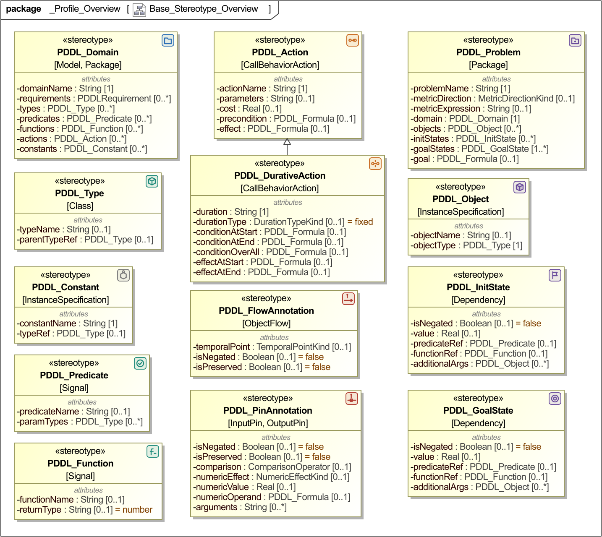
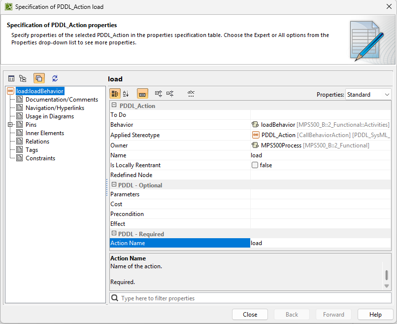

# PDDL_SysML_Profile

A SysML profile for annotating SysML models with PDDL planning semantics. The profile
provides stereotypes for types, predicates, functions, actions, and initial and goal states,
and it checks the annotation with OCL constraints. Built and tested with Magic Systems of Systems Architect (MSoSA) 2024x.
MSoSA runs on the MagicDraw platform, whose project format is `.mdzip`.

## Contents

    profile/           The profile as an MSoSA project (.mdzip)
    rules/             Every rule with its severity, context and purpose, also in standard OCL
    images/            The base stereotypes and a specification dialog

## Scope

| | |
|---|---|
| Stereotypes | 35 (13 base, 22 formula) |
| Rules (OCL constraints) | 84 (70 errors, 13 warnings, 1 info) |
| Enumerations | 7 |
| Extended metaclasses | 10 |

The catalog in `rules/` is extracted from the profile rather than maintained by hand.

## Usage

Include the profile in MSoSA as a *used project*. The stereotypes then become available,
and the validation suite `PDDL_Validation_Suite` checks an annotated model for well-formedness.
In the specification dialog of an annotated element, the tags appear in groups such as
`PDDL - Required` and `PDDL - Optional`, with the documentation of the selected tag below.

The suite checks the model before any PDDL is generated. A planner sees only the generated PDDL.
Some faults are valid PDDL that no planner reports, such as a disjunction with a single operand.

Preconditions and effects can be modeled either through formula stereotypes or through
typed pins. Rules that check actions accept both. Numeric terms can be combined with
`«PDDL_ArithmeticExpression»` (+, -, *, /). A pin typed with a `«PDDL_Function»` carries a
numeric condition (`comparison` on an input pin) or a numeric effect (`numericEffect` on an
output pin). The right-hand side is `numericValue` or `numericOperand`, both tags of
`«PDDL_PinAnnotation»`.
A predicate-typed pin can name the arguments of its atom in the tag `arguments`, as the names of
parameter pins of the same action (`['?c', '?from']`). The same predicate can then appear on an
input and an output pin with different arguments, as in a move from `?from` to `?to`.

Every rule carries a message that names the problem. Most messages also say how to fix it:

    PRB-07: Init state references a function but has no value. A numeric initial
            state needs one, e.g. (= (distance a b) 42).

## Related repositories

- Transforming annotated models into PDDL: [`sysml-pddl-transformation`](https://github.com/HamiedNabizada/sysml-pddl-transformation)
- Application example with 19 configurations and three for rule coverage: [`mps500-planning-example`](https://github.com/HamiedNabizada/mps500-planning-example)

## License

Copyright (c) 2026 Hamied Nabizada. The profile, the rule catalog, the images and this documentation are licensed under the
Creative Commons Attribution 4.0 International License (CC BY 4.0), see [LICENSE](LICENSE).
